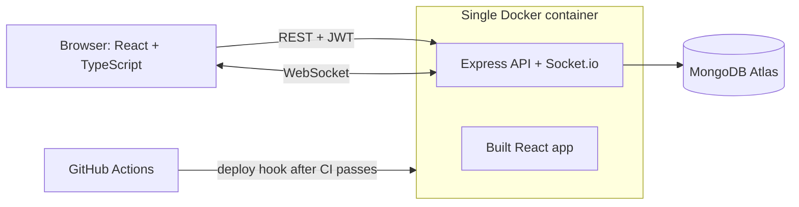

# Issue Tracker


A multi-tenant issue tracker (think a small Linear or Jira) built with the MERN stack in TypeScript. Teams get private organizations, role-based permissions, and a kanban board that updates live on everyone's screen.

**Live demo:** <LIVE_URL>
The free host sleeps when idle, so the first load can take about a minute.

**Demo accounts** (password for both: `demo-password-123`)

| Email | Role |
|---|---|
| demo.owner@example.com | Owner |
| demo.dev@example.com | Contributor |

Log in as each in two browser windows and drag a card in one to watch the other update.

<!-- Add board and live-sync screenshots under docs/screenshots before linking them here. -->

## Features

- **Organizations and roles.** Four roles (owner, lead, contributor, guest). Every query is scoped to the caller's organization, so one team can never see another's data.
- **Projects and a kanban board.** Drag tickets between Todo, In Progress, Review and Done.
- **Real-time sync.** Changes appear on every collaborator's screen without a refresh, over Socket.io.
- **Comments, @mentions and notifications.** Mentioning a teammate notifies them live; the bell shows an unread count.
- **Secure sessions.** Short-lived access tokens, an httpOnly refresh cookie, and silent token refresh.
- **Production hardening.** Rate limiting, input allow-lists, security headers, and an automated test suite.

## Architecture



In production the API, the sockets and the built React app are served from one container on one origin. The frontend and backend are still separate projects in this repo.

## Tech stack

| Area | Tools |
|---|---|
| Frontend | React, TypeScript, Vite, Tailwind CSS, dnd-kit, React Router, Axios |
| Backend | Node.js, Express, TypeScript, Mongoose, Socket.io |
| Database | MongoDB (Atlas in production) |
| Security | JWT, bcrypt, Helmet, express-rate-limit |
| Testing | Vitest, Supertest, real MongoDB (no mocks) |
| DevOps | Docker (multi-stage builds), Docker Compose, GitHub Actions, Render |

## Engineering decisions

- **Multi-tenancy through a membership collection.** Users do not belong to an organization directly. A `Membership(userId, orgId, role)` document joins them, so one person can have different roles in different organizations. Tickets also store their own `orgId`, which lets the board query hit a single compound index `(orgId, projectId, status)` without joins. Trade-off: `orgId` is stored twice, so it must never be editable after creation (see the allow-list below).
- **Tenant isolation enforced in the query, not only the route.** Updates and deletes filter on both the ticket id and the caller's `orgId`. Knowing another organization's ticket id is not enough to touch it, and automated tests cover this.
- **Tokens.** The access token lives in memory (not `localStorage`) and expires in 15 minutes. The refresh token is an httpOnly cookie. An Axios interceptor refreshes on a 401 and retries the request once, and concurrent failures share a single refresh call. Trade-off: a page reload needs one extra round trip to restore the session.
- **Real-time rooms with authorization.** Each project is a Socket.io room. Joining checks that the user belongs to the project's organization, the same rule the REST routes use. The client re-joins and reloads the board after any reconnect, because rooms do not survive a dropped connection.
- **Optimistic drag-and-drop.** The card moves instantly and snaps back if the server rejects the change (for example, a guest trying to edit).
- **Mass-assignment protection.** `PATCH /tickets/:id` accepts only an allow-list of fields. Without it, a client could send `orgId` and move a ticket into another tenant. Assignees must also be members of the organization.
- **Roles as a ranking.** Roles are ordered, and each route declares the minimum rank it needs. Invites are capped below the inviter's own role, so a lead cannot create an owner.
- **One container, one origin in production.** Serving the SPA and the API together removes CORS configuration and keeps the refresh cookie first-party. Trade-off: the frontend and API scale together.
- **Tests run against a real database.** Integration tests use a real MongoDB container, so indexes, unique constraints and query filters are exercised for real.

## Testing and CI/CD

- **Tests:** 25 integration tests covering authentication, tenant isolation and role permissions (Vitest + Supertest).
- **CI** (GitHub Actions, pushes to `main`/`master` and pull requests): backend type-check, tests against a MongoDB service container, and build; frontend lint and build; Docker image builds.
- **CD:** on a push to the default branch, after every job passes, a deploy hook triggers a new deploy. A failing check never ships.

## Demo data

To populate the configured database with the public demo accounts and sample
tickets, set `MONGO_URI` to the intended database and run:

```bash
cd backend
MONGO_URI="<your MongoDB connection string>" npm run seed
```

The script is safe to re-run when the demo owner already exists. It creates
accounts with the shared demo password shown above; do not use this seed on a
database containing real user data.

## Run it locally

**With Docker** (starts MongoDB, the API and the frontend):

```bash
docker compose up --build
# open http://localhost:8080
```

**For development** (hot reload):

```bash
# backend/.env
# PORT=5000
# MONGO_URI=mongodb://127.0.0.1:27017/issue-tracker
# JWT_ACCESS_SECRET=change-me
# JWT_REFRESH_SECRET=change-me-too

cd backend && npm install && npm run dev

# frontend/.env
# VITE_API_URL=http://localhost:5000/api
# VITE_SOCKET_URL=http://localhost:5000

cd frontend && npm install && npm run dev
# open http://localhost:5173
```

**Tests:**

```bash
docker run -d --name mongo-test -p 27017:27017 mongo:7
cd backend && npm test
```

## Known limitations and roadmap

Limitations I know about:

- The rate limiter keeps counters in memory, so limits are per server instance. Moving them to Redis is planned.
- Invites only work for people who already have an account, and there is no email verification or password reset.
- Socket events are not rate limited.
- The free host sleeps when idle, so the first request after a quiet period is slow.

Planned next:

- Ticket search, starting with MongoDB text search and later semantic search with embeddings
- File attachments on tickets
- Redis for caching and distributed rate limiting
- Admin dashboard and analytics (velocity, cycle time)
- Internationalization