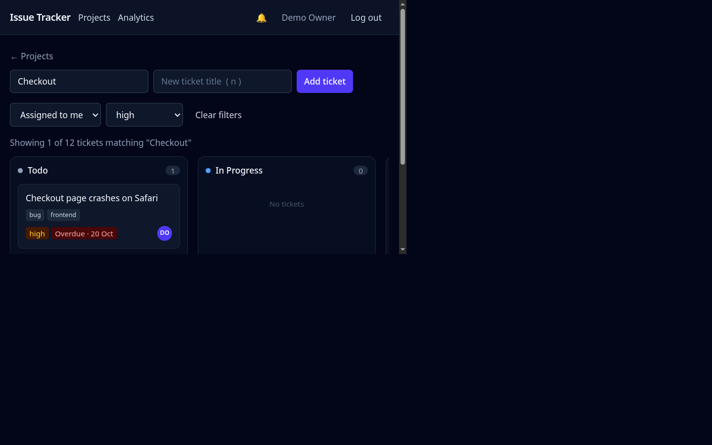
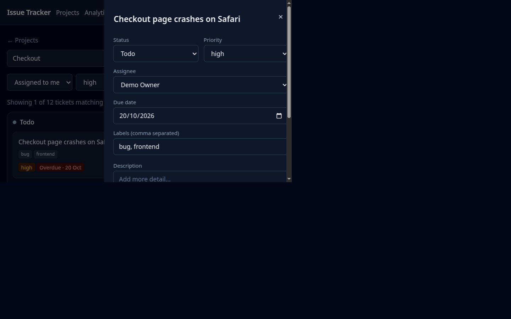
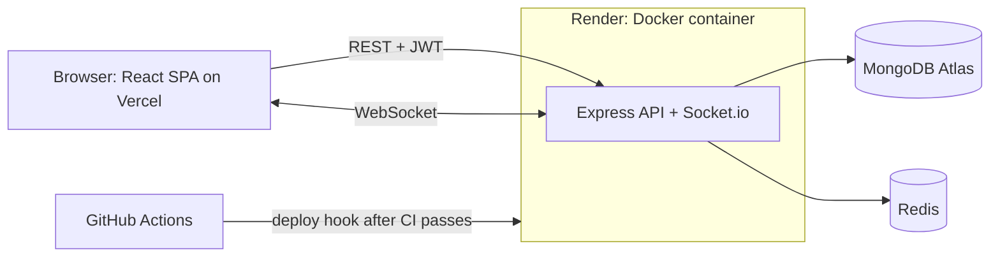

# Issue Tracker


A multi-tenant issue tracker (think a small Linear or Jira) built with the MERN stack in TypeScript. Teams get private organizations, role-based permissions, and a kanban board that updates live on everyone's screen.

**Live website:** [Open the app](https://multi-tenant-tan-seven.vercel.app)

The frontend is hosted on Vercel and the API runs on Render. Render's free
service may sleep when idle, so the first login or API request after a quiet
period can take about a minute.

**Demo accounts** (available after the production database has been seeded;
password for both: `demo-password-123`)

| Email | Role |
|---|---|
| demo.owner@example.com | Owner |
| demo.dev@example.com | Contributor |

Log in as each in two browser windows and drag a card in one to watch the other update.





## Features

- **Organizations and roles.** Four roles (owner, lead, contributor, guest). Every query is scoped to the caller's organization, so one team can never see another's data.
- **Member management.** Invite, change roles and remove or leave, with escalation rules (nobody can grant or modify a role at or above their own).
- **Projects and a kanban board.** Drag tickets between Todo, In Progress, Review and Done.
- **Ticket collaboration.** Ticket detail panel with inline editing (title, description, priority, status, assignee, labels), live-updating comments with @mentions, toast feedback, and a role-aware interface (guests get a read-only board).
- **Due dates and focused boards.** Due dates are highlighted when overdue, due today, or upcoming. Assignee and priority filters are shareable URL parameters; `/` focuses search, `n` focuses new ticket, and loading skeletons preview the board while it loads.
- **Ticket search.** Search tickets with a MongoDB full-text index, ranked by relevance and scoped to the organization.
- **Analytics dashboard for leads and owners.** View status and priority breakdowns, weekly throughput, workload per person, and average cycle time.
- **Real-time sync.** Changes appear on every collaborator's screen without a refresh, over Socket.io.
- **Redis integrations.** Redis-backed analytics caching and a Socket.io adapter support multiple servers. Redis is optional; rate limiting uses the in-memory store.
- **Comments, @mentions and notifications.** Mentioning a teammate notifies them live; the bell shows an unread count.
- **Secure sessions.** Short-lived access tokens, an httpOnly refresh cookie, and silent token refresh.
- **Production hardening.** Rate limiting, input allow-lists, security headers, and an automated test suite.

## Architecture



The frontend and backend are deployed separately: Vercel serves the React app,
while Render serves the API and Socket.io. The browser connects across these
origins, so the backend's `CLIENT_ORIGIN` must match the Vercel site URL.

## Tech stack

| Area | Tools |
|---|---|
| Frontend | React, TypeScript, Vite, Tailwind CSS, dnd-kit, React Router, Axios |
| Backend | Node.js, Express, TypeScript, Mongoose, Socket.io |
| Database | MongoDB (Atlas in production) |
| Cache and scaling | Redis (ioredis), Socket.io Redis adapter |
| Security | JWT, bcrypt, Helmet, express-rate-limit |
| Testing | Vitest, Supertest, real MongoDB (no mocks) |
| DevOps | Docker (multi-stage builds), Docker Compose, GitHub Actions, Render |

## Engineering decisions

- **Multi-tenancy through a membership collection.** Users do not belong to an organization directly. A `Membership(userId, orgId, role)` document joins them, so one person can have different roles in different organizations. Tickets also store their own `orgId`, which lets the board query hit a single compound index `(orgId, projectId, status)` without joins. Trade-off: `orgId` is stored twice, so it must never be editable after creation (see the allow-list below).
- **Tenant isolation enforced in the query, not only the route.** Updates and deletes filter on both the ticket id and the caller's `orgId`. Knowing another organization's ticket id is not enough to touch it, and automated tests cover this.
- **Tokens.** The access token lives in memory (not `localStorage`) and expires in 15 minutes. The refresh token is an httpOnly cookie. An Axios interceptor refreshes on a 401 and retries the request once, and concurrent failures share a single refresh call. Trade-off: a page reload needs one extra round trip to restore the session.
- **Real-time rooms with authorization.** Each project is a Socket.io room. Joining checks that the user belongs to the project's organization, the same rule the REST routes use. The client re-joins and reloads the board after any reconnect, because rooms do not survive a dropped connection.
- **Member removal and role changes.** Roles live in the database, not in the token, so role changes and removals apply on the next request. Because socket rooms outlive membership, removing a member also evicts them from the organization's project rooms. Members' tickets are unassigned on removal rather than deleted.
- **Ticket editing and role-aware UI.** Fields save on blur and dropdowns save immediately. The role comes from the member list, so the UI hides actions you can't perform, but the server remains the authority and rejects them regardless.
- **Due dates and board filters.** Due dates are stored as midnight UTC of the chosen calendar day, so no timezone can shift them, and overdue is computed from the date string rather than a timestamp. Filters are stored in URL query parameters so they survive reloads and can be shared as links.
- **Optimistic drag-and-drop.** The card moves instantly and snaps back if the server rejects the change (for example, a guest trying to edit).
- **Mass-assignment protection.** `PATCH /tickets/:id` accepts only an allow-list of fields. Without it, a client could send `orgId` and move a ticket into another tenant. Assignees must also be members of the organization.
- **Search index and relevance.** Search uses a compound text index with `orgId` as the prefix, so queries are tenant-scoped and index-backed. Title matches are weighted 5x over description matches. Trade-off: `$text` matches whole stemmed words only.
- **Analytics aggregation.** Analytics use a single `$facet` aggregation, so MongoDB scans the organization's tickets once and returns every chart's data together. The match on `orgId` uses the existing compound index. A `completedAt` field is set when a ticket enters Done, which makes cycle time possible. Trade-off: this records only the latest completion, not the full status history, so reopened tickets lose their earlier completion time.
- **Redis cache and rate limits.** Analytics use cache-aside for 60 seconds. Entries are invalidated by bumping a per-organization version number included in the key, avoiding a Redis key scan; the TTL is the safety net. Concurrent cache misses for the same key share one database computation. If Redis is unavailable, analytics fall back to querying the database. Rate limits use in-memory counters, so they are per server instance and reset when that server restarts.
- **Socket.io scaling.** A Redis adapter broadcasts socket events across backend servers. Multiple servers using Socket.io's long-polling transport also need sticky sessions at the load balancer.
- **Roles as a ranking.** Roles are ordered, and each route declares the minimum rank it needs. Invites are capped below the inviter's own role, so a lead cannot create an owner.
- **Separate frontend and backend deployments.** Vercel serves the frontend and Render runs the API and Socket.io. This requires an exact CORS origin and a cross-site refresh cookie (`SameSite=None; Secure`) in production.
- **Tests run against a real database.** Integration tests use a real MongoDB container, so indexes, unique constraints and query filters are exercised for real.

## Testing and CI/CD

- **Tests:** Integration tests cover authentication, tenant isolation, role permissions and Redis-backed analytics caching (Vitest + Supertest).
- **CI** (GitHub Actions, pushes to `main`/`master` and pull requests): backend type-check, tests against MongoDB and Redis service containers, and build; frontend lint and build; Docker image builds.
- **CD:** on a push to the default branch, after every CI job passes, GitHub Actions triggers a Render deploy hook. Vercel deployments are handled by the Vercel Git integration when enabled.

## Performance

The k6 benchmark exercises analytics for an organization with 50,000 tickets,
20 concurrent readers, and one ticket update per second for 30 seconds. The
load generator, API, MongoDB and Redis share the same machine, so results are
useful for comparing configurations on that machine, not estimating production
capacity.

| Setup | Average latency | p95 latency | Throughput |
|---|---:|---:|---:|
| No Redis cache | Not measured | Not measured | Not measured |
| Redis cache with version-key invalidation | Not measured | Not measured | Not measured |
| Redis cache with request coalescing | Not measured | Not measured | Not measured |

To generate isolated benchmark data, configure `MONGO_URI` to a local database
whose name contains `bench` and run `cd backend && npm run load-data`. The
loader refuses to write to any database whose name does not contain `bench` or
`test`. It prints a ready-to-run k6 Docker command with the generated
organization and ticket IDs. For each configuration, run that command twice
and record the second run's analytics average and p95 latency and `http_reqs`
throughput. `DISABLE_RATE_LIMITS=1` disables rate limits only outside
production. No results are reported above because k6 could not be run in the
environment used to prepare this benchmark.

## Demo data

To populate the configured database with the public demo accounts and sample
tickets, set `MONGO_URI` to the intended database and run:

```bash
cd backend
MONGO_URI="<your MongoDB connection string>" npm run seed
```

The script is safe to re-run when the demo owner already exists. It creates
accounts with the shared demo password shown above; do not use this seed on a
database containing real user data.

## Run it locally

**With Docker** (starts MongoDB, Redis, the API and the frontend):

```bash
docker compose up --build
# open http://localhost:8080
```

**For development** (hot reload):

```bash
# backend/.env
# PORT=5000
# MONGO_URI=mongodb://127.0.0.1:27017/issue-tracker
# JWT_ACCESS_SECRET=change-me
# JWT_REFRESH_SECRET=change-me-too

cd backend && npm install && npm run dev

# frontend/.env
# VITE_API_URL=http://localhost:5000/api
# VITE_SOCKET_URL=http://localhost:5000

cd frontend && npm install && npm run dev
# open http://localhost:5173
```

**Tests:**

```bash
docker run -d --name mongo-test -p 27017:27017 mongo:7
cd backend && npm test
```

By default, the Redis-backed cache tests are skipped. To run them locally, start
Redis and set `TEST_REDIS_URL`:

```bash
docker run -d --name redis-test -p 6379:6379 redis:7
cd backend && TEST_REDIS_URL=redis://127.0.0.1:6379 npm test
```

## Known limitations and roadmap

Limitations I know about:

- Rate-limit counters are in memory, so they are per server instance and reset when a server restarts. The free Redis instance is not persistent, so a restart clears the analytics cache. Running multiple servers with Socket.io's long-polling transport also needs sticky sessions at the load balancer.
- Only existing users can be added (no email invitations), and ownership can't be transferred.
- If someone else edits a ticket while its panel is open, the panel keeps your local text until it's reopened.
- A board loads every ticket in the project, and filtering is done in the browser. That's fine at this scale, but pagination would be needed for thousands of tickets per project.
- There is no email verification or password reset.
- Socket events are not rate limited.
- Search does not match partial words or typos.
- The free host sleeps when idle, so the first request after a quiet period is slow.

Planned next:

- File attachments on tickets
- Admin dashboard
- Internationalization